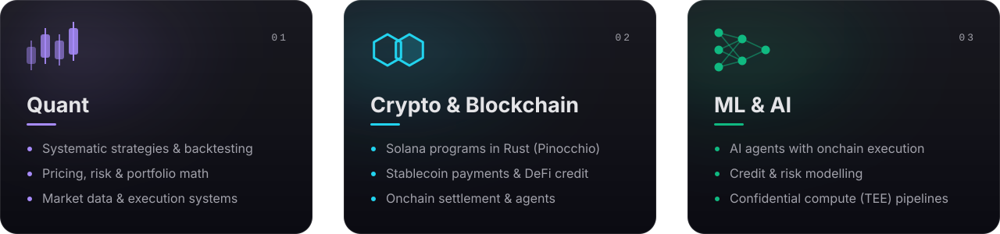
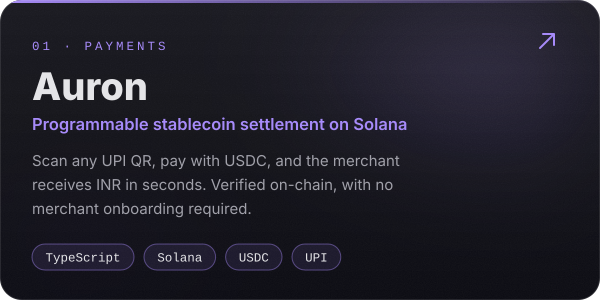
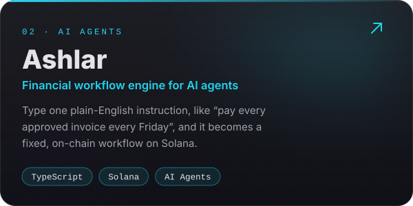
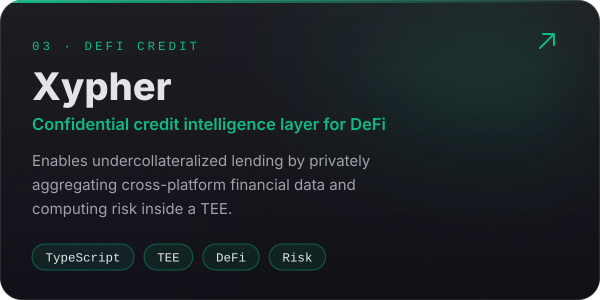
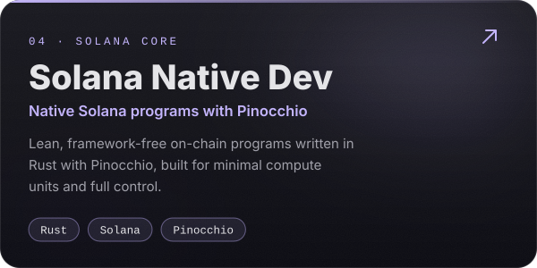
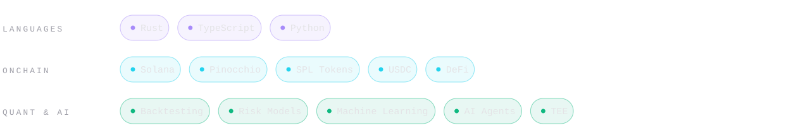
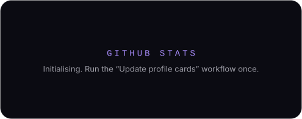
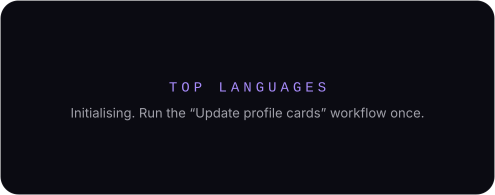
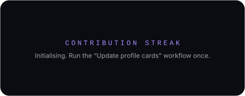

  

  

  &nbsp;
  &nbsp;
  

  

- **Building:** [Auron](https://github.com/anirudhh206/Auron), [Ashlar](https://github.com/anirudhh206/Ashlar) and [Xypher](https://github.com/anirudhh206/Xypher): stablecoin settlement, agentic finance and confidential credit on Solana
- **Working in:** Rust (Pinocchio), TypeScript, Python
- **Tracking:** [agave](https://github.com/anirudhh206/agave) (Solana validator client) and [quasar](https://github.com/anirudhh206/quasar) (program framework)

  
  

  
  

  

  
  

  

  

  

